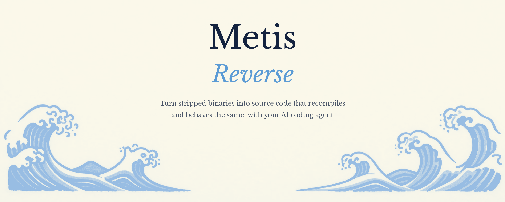
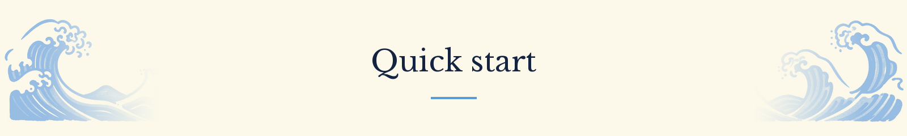
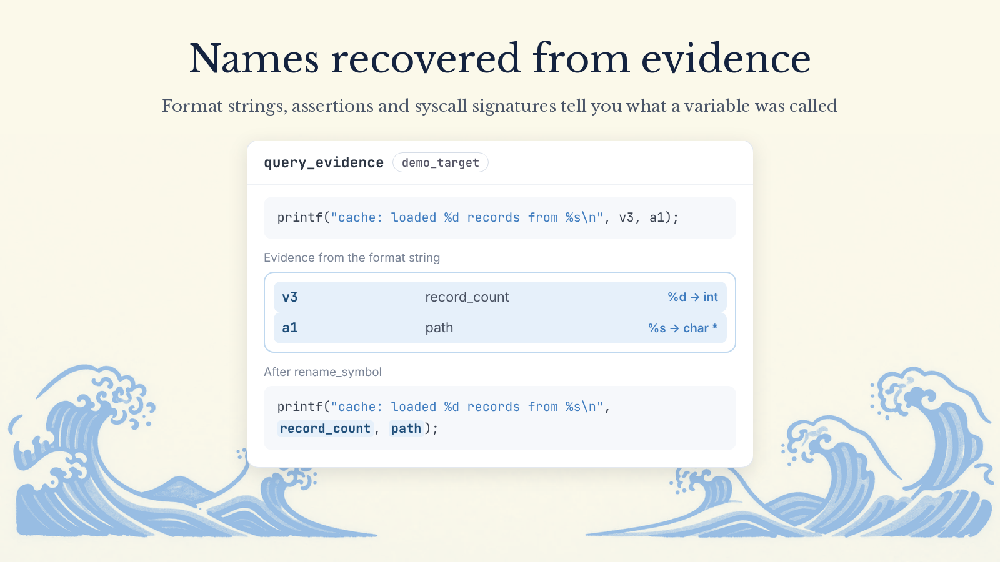
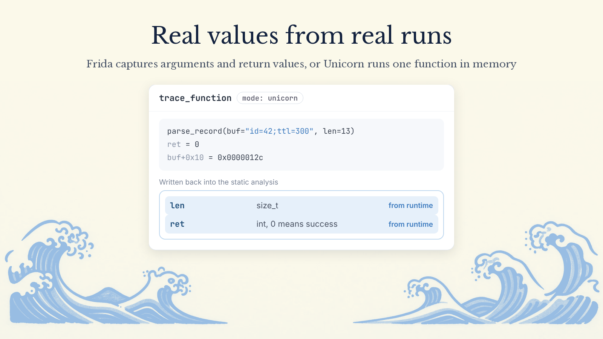
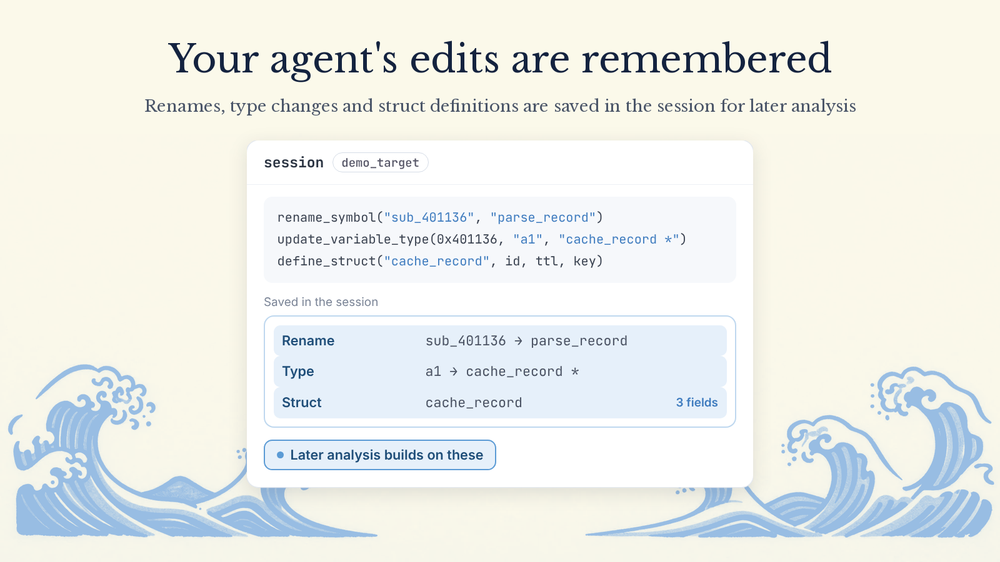
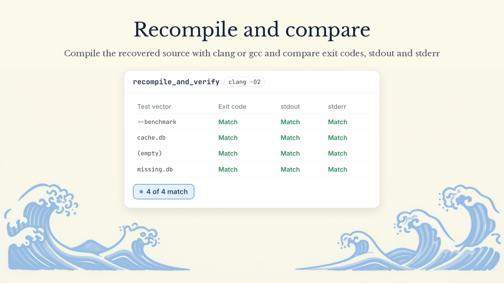
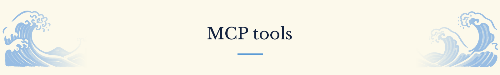

<p align="center">
  
</p>

<p align="center">
  Turn stripped binaries into source code that recompiles and behaves the same, with your AI coding agent.
</p>

<p align="center">
  <b>English</b> · <a href="README.zh-CN.md">简体中文</a>
</p>

<p align="center">
  <a href="https://opensource.org/licenses/MIT"></a>
  <a href="https://www.python.org/downloads/"></a>
  <a href="https://github.com/jlowin/fastmcp"></a>
</p>

<p align="center"></p>

**1. Install** (Python 3.12+; `clang` or `gcc` is needed for recompile verification)

```bash
git clone https://github.com/Wholiver/metis-reverse.git
cd metis-reverse
uv venv && source .venv/bin/activate
uv pip install -e ".[dev]"
```

Without uv: `pip install git+https://github.com/Wholiver/metis-reverse.git`.

**2. Connect a client.** Add this to your MCP config. It works with Claude Desktop, Cursor, Cline and Windsurf.

```json
{
  "mcpServers": {
    "metis-reverse": {
      "command": "metis-reverse",
      "args": ["--transport", "stdio"]
    }
  }
}
```

**3. Try it.** Build the bundled demo, then ask your agent to analyze it.

```bash
cd demo && make
```

> Analyze the stripped binary `demo/demo_target`. Use evidence from format strings and assertions to work out the cache record struct, then reconstruct the C source and verify it with differential testing.

<p align="center"></p>

**Names recovered from evidence.** Original variable names, structs and types come back from format strings, assertions, syscall signatures and language metadata (Go pclntab, C++ RTTI and more), and each one records where it came from and how confident it is.

<p align="center"></p>

**Works out of the box, and picks up Ghidra when it's installed.** LIEF, Capstone, angr and Tree-sitter are built in, so no external decompiler is required. If Ghidra is installed, it's connected automatically.

<p align="center"></p>

**Real values from real runs.** Frida captures arguments and return values at runtime, or Unicorn runs a single function in memory, and the results are written back into the static analysis.

<p align="center"></p>

**Your agent's edits are remembered.** Renames, type changes and struct definitions are saved in the session, and later analysis builds on them.

<p align="center"></p>

**Recompile and compare.** The reconstructed source is compiled with clang or gcc, then run side by side with the original on the same inputs, comparing exit codes, stdout and stderr.

<p align="center"></p>

<p align="center"></p>

| Tool | What it does |
|:---|:---|
| `open_session` | Opens a binary or script (ELF, PE, Mach-O, DEX, JS) and starts an analysis session |
| `close_session` | Closes a session and frees its memory and caches |
| `list_functions` | Lists detected functions, filterable by name and confidence |
| `disassemble` / `disassemble_range` | Disassembles from a given address |
| `get_cfg` | Returns the control flow graph for the whole binary or one function |
| `decompile` | Decompiles a function into pseudocode annotated with evidence |
| `query_evidence` | Looks up evidence and provenance for a symbol or address |
| `rename_symbol` | Renames a symbol and records why |
| `update_variable_type` | Changes the type of a local variable or parameter |
| `define_struct` | Defines a struct and computes offsets and size |
| `trace_function` | Runs a function under Frida or Unicorn and writes the results back as evidence |
| `recompile_and_verify` | Compiles reconstructed source and verifies it against the original |
| `run_differential_test` | Compares output and exit codes of the original and rebuilt programs |

<p align="center"></p>

<details>
<summary><b>Claude Desktop</b></summary>

Config file location:

- macOS: `~/Library/Application Support/Claude/claude_desktop_config.json`
- Windows: `%APPDATA%\Claude\claude_desktop_config.json`
- Linux: `~/.config/Claude/claude_desktop_config.json`

If you use a virtual environment, point `command` at the full path:

```json
{
  "mcpServers": {
    "metis-reverse": {
      "command": "/path/to/metis-reverse/.venv/bin/metis-reverse",
      "args": ["--transport", "stdio"]
    }
  }
}
```
</details>

<details>
<summary><b>Cursor / Windsurf / Cline</b></summary>

Add the config from Quick Start to `.cursor/mcp.json` or your Cline settings.
</details>

<details>
<summary><b>SSE remote mode</b></summary>

```bash
metis-reverse --transport sse --host 127.0.0.1 --port 8000
```
</details>

<p align="center"></p>

```bash
pytest tests/unit/                     # unit tests
pytest tests/e2e/                      # end-to-end and benchmark checks
pytest --cov=metis_reverse tests/      # everything, with coverage
```

<p align="center"></p>

Metis Reverse is built on these open-source projects:

- [FastMCP](https://github.com/jlowin/fastmcp) and [Model Context Protocol](https://modelcontextprotocol.io/)
- [LIEF](https://github.com/lief-project/LIEF): ELF, PE and Mach-O parsing
- [Capstone](https://www.capstone-engine.org/): multi-architecture disassembly
- [Unicorn](https://www.unicorn-engine.org/): CPU emulation based on QEMU
- [angr](https://angr.io/): binary analysis and decompilation
- [Frida](https://frida.re/): runtime instrumentation
- [Tree-sitter](https://tree-sitter.github.io/): syntax tree parsing
- [Ghidra](https://ghidra-sre.org/): software reverse engineering suite
- [Rich](https://github.com/Textualize/rich) and [Pydantic](https://docs.pydantic.dev/)

<p align="center"></p>

Released under the [MIT License](LICENSE).
