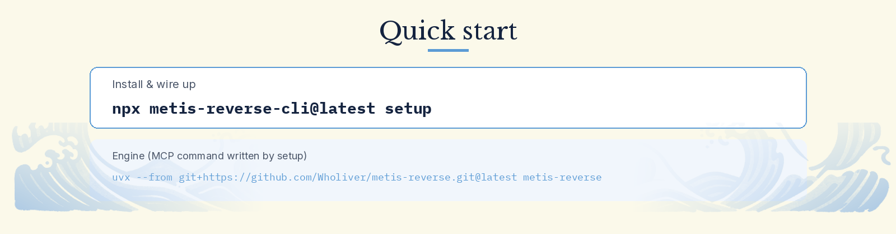
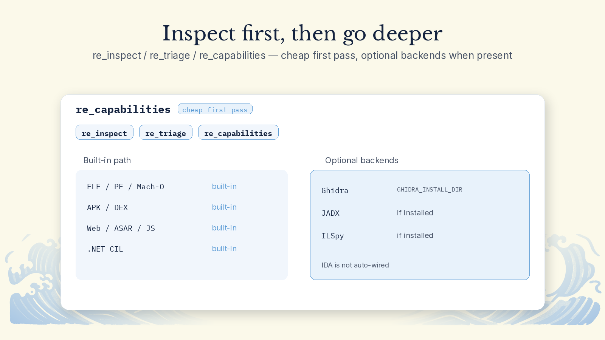
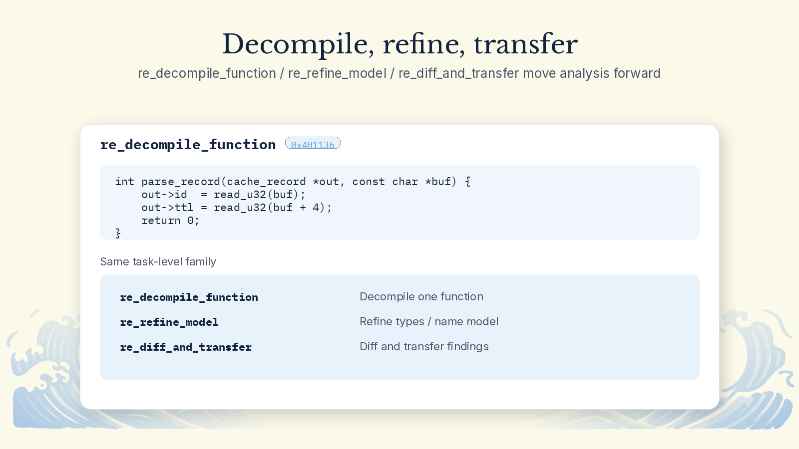
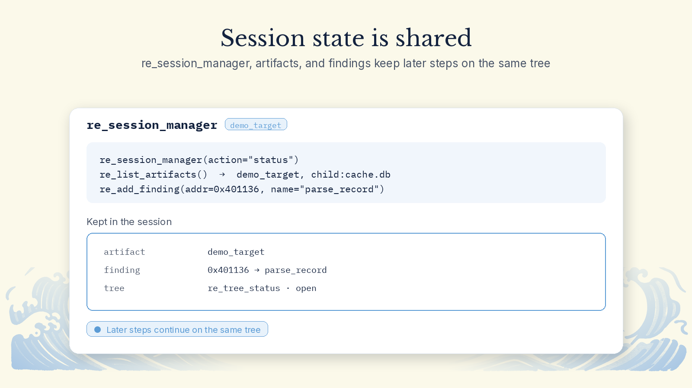
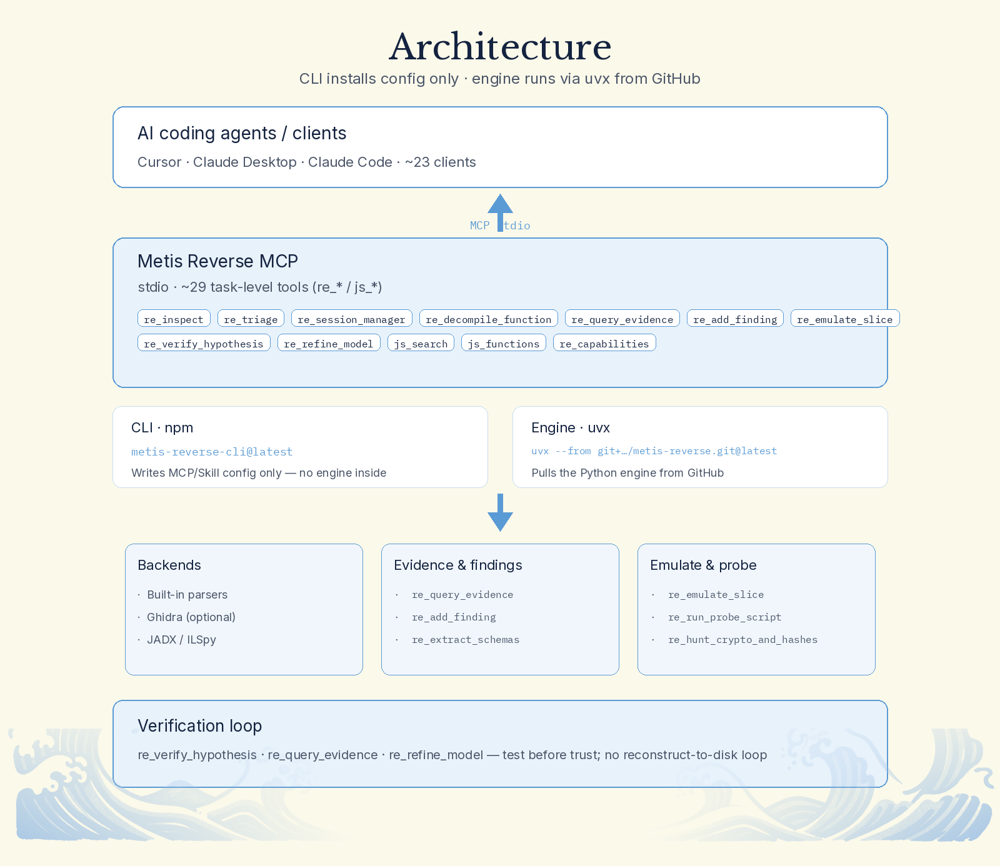

<p align="center">
  
</p>

<p align="center">
  Reverse-engineering MCP for your AI assistants — an MCP server plus a one-click multi-agent installer.
</p>

<p align="center">
  <b>English</b> · <a href="README.zh-CN.md">简体中文</a>
</p>

<p align="center">
  <a href="https://www.npmjs.com/package/metis-reverse-cli"></a>
  <a href="LICENSE"></a>
  <a href="https://www.python.org/downloads/"></a>
  <a href="https://nodejs.org/">=18"></a>
  <a href="https://github.com/Wholiver/metis-reverse/stargazers"></a>
  <a href="#community"></a>
</p>

> **v1.0.1 — install the right package.** The published CLI is [`metis-reverse-cli`](https://www.npmjs.com/package/metis-reverse-cli) (`npm` dist-tag **`latest` → 1.0.1**). The older npm name `metis-reverse` is still stuck at **0.0.1** and is **not** this release. Prefer `npx metis-reverse-cli@latest setup`. The engine repo also has a moving Git tag **`latest`** (currently = `v1.0.1`) for `uvx` / source downloads.

<p align="center"></p>

**1. Install & connect.** You need [Node.js](https://nodejs.org/) 18+ and [uv](https://docs.astral.sh/uv/) (the MCP engine is pulled with `uvx` from GitHub; there is **no** PyPI package yet).

Step-by-step beginner guide: [docs/INSTALL.md](docs/INSTALL.md).

```bash
npx metis-reverse-cli@latest setup
```

Or install the CLI globally, then run the same wizard:

```bash
npm install -g metis-reverse-cli@latest
metis setup          # same binary as `metis-reverse`
```

`setup` finds coding agents on your machine, shows what it will write (MCP + Skill + Cursor rules), keeps a `.bak` of existing MCP configs, and asks before writing. When you see `Setup complete! Please restart your selected agents to activate Metis Reverse.`, restart the agent. Check with:

```bash
metis doctor
# or: npx metis-reverse-cli@latest doctor
```

Remove only Metis Reverse (other MCP servers stay):

```bash
metis uninstall
```

Dry-run / preview without writing:

```bash
metis preview
# same as: metis setup --dry-run
```

<details>
<summary><b>Which apps it can configure (~23)</b></summary>

`setup` shows a picker. Skip the menu with `--client` (repeatable) and `--yes`, e.g. `metis setup --client cursor --client claude_code --yes`.

| App | `--client` | App | `--client` |
|:---|:---|:---|:---|
| Cursor | `cursor` | Claude Code | `claude_code` |
| Claude Desktop | `claude_desktop` | Codex | `codex` |
| Gemini CLI | `gemini_cli` | Antigravity | `antigravity` |
| VS Code | `vscode` | Windsurf | `windsurf` |
| Trae | `trae` | OpenCode | `opencode` |
| WorkBuddy | `workbuddy` | GitHub Copilot CLI | `copilot_cli` |
| Devin | `devin` | Kimi Code | `kimi` |
| Qwen Code | `qwen_code` | Grok Build | `grok_build` |
| Hermes | `hermes` | Qoder | `qoder` |
| Factory Droid | `droid` | OMP | `omp` |
| Pi | `pi` | ZCode | `zcode` |
| DeepSeek Harness | `dsh` | | |

Cursor also gets `~/.cursor/skills/metis-reverse` and `~/.cursor/rules/metis-reverse.mdc`. Fully quit Claude Desktop before running `setup` for it.

</details>

<details>
<summary><b>Advanced: manual MCP config & source install</b></summary>

What `setup` writes (engine via GitHub + uvx — **not** npm, **not** PyPI), pinned to the moving **`latest`** tag (currently `v1.0.1`):

```json
{
  "mcpServers": {
    "metis-reverse": {
      "command": "uvx",
      "args": [
        "--from",
        "git+https://github.com/Wholiver/metis-reverse.git@latest",
        "metis-reverse"
      ]
    }
  }
}
```

Same idea on the CLI: `uvx --from git+https://github.com/Wholiver/metis-reverse.git@latest metis-reverse`.

Optional env (not written by default): `GHIDRA_INSTALL_DIR`, `METIS_SIDECAR_DIR`.

From a source checkout (Python **3.10+**), clone the **`latest`** tag (or `v1.0.1`):

```bash
git clone --branch latest --depth 1 https://github.com/Wholiver/metis-reverse.git
cd metis-reverse
uv venv && source .venv/bin/activate
uv pip install -e ".[dev]"
```

Or download the source archive: [latest.zip](https://github.com/Wholiver/metis-reverse/archive/refs/tags/latest.zip).

Then point MCP `command` at that environment’s `metis-reverse`, or keep using the `uvx --from git+…@latest` form above.

</details>

**2. Try it.** Build the bundled `demo`, then ask your agent to inspect it with the `re_*` / `js_*` tools.

```bash
cd demo && make
```

> Inspect `demo/demo_target`. Triage the binary, decompile the interesting functions, pull evidence for names and types, then verify any hypothesis before you trust it.

<table>
<tr>
<td width="50%" valign="top"><br><br>

**Evidence stays attached.** `re_query_evidence` and `re_add_finding` keep provenance on symbols and addresses so the agent can cite why a name or type is trusted.

</td>
<td width="50%" valign="top"><br><br>

**Inspect first, then go deeper.** `re_inspect` / `re_triage` / `re_capabilities` give a cheap first pass; optional backends (e.g. Ghidra via `GHIDRA_INSTALL_DIR`) are used when present, otherwise the built-in path still runs.

</td>
</tr>
<tr>
<td width="50%" valign="top"><br><br>

**Decompile, refine, transfer.** Task-level tools like `re_decompile_function`, `re_refine_model`, and `re_diff_and_transfer` move analysis forward without dumping raw one-shot APIs on the agent.

</td>
<td width="50%" valign="top"><br><br>

**Probe when static is not enough.** `re_emulate_slice` and `re_run_probe_script` pull concrete values from a slice or a probe and feed them back into the session.

</td>
</tr>
<tr>
<td width="50%" valign="top"><br><br>

**Session state is shared.** `re_session_manager`, artifact lists, and findings keep later steps on the same tree — the agent does not start from zero every turn.

</td>
<td width="50%" valign="top"><br><br>

**Verify before you ship a claim.** `re_verify_hypothesis` and related checks push the agent to test ideas instead of narrating them.

</td>
</tr>
</table>

<p align="center"></p>

<p align="center"></p>

**About 29 MCP tools** in the v1.0.1 engine (handlers under `re_*` and `js_*`). Grouped by task below.

<details>
<summary><b>Session · triage · artifacts</b></summary>

| Tool | Role |
|:---|:---|
| `re_session_manager` | Open / manage analysis sessions |
| `re_inspect` | First-pass look at a target |
| `re_triage` | Cheap ranking of what matters |
| `re_tree_status` | Status of the analysis tree |
| `re_list_artifacts` / `re_inspect_artifact` | List and inspect artifacts |
| `re_capabilities` | What this environment can do |
| `re_register_child_artifact` | Attach a child artifact |

</details>

<details>
<summary><b>Binary structure · decompile · schemas</b></summary>

| Tool | Role |
|:---|:---|
| `re_inspect_binary_structure` | Layout / sections / structure |
| `re_read_file_range` | Read a byte range |
| `re_translate_address` | Address translation |
| `re_query_function` | Function metadata |
| `re_decompile_function` | Decompile one function |
| `re_bridge_map` | Bridge / IPC-style maps |
| `re_extract_schemas` | Extract schemas / shapes |

</details>

<details>
<summary><b>JavaScript / Electron-style targets</b></summary>

| Tool | Role |
|:---|:---|
| `js_list_modules` / `js_get_module` | Modules |
| `js_list_closures` | Closures |
| `js_search` | Search |
| `js_functions` / `js_strings` | Functions and strings |

</details>

<details>
<summary><b>Hunt · emulate · verify · evidence</b></summary>

| Tool | Role |
|:---|:---|
| `re_hunt_crypto_and_hashes` | Crypto / hash hunting |
| `re_emulate_slice` | Emulate a slice |
| `re_run_probe_script` | Run a probe |
| `re_verify_hypothesis` | Test a hypothesis |
| `re_refine_model` | Refine the working model |
| `re_diff_and_transfer` | Diff and transfer findings |
| `re_query_evidence` / `re_add_finding` | Evidence and findings |

</details>

<p align="center"></p>

| Command | What it does |
|:---|:---|
| `metis setup` | Write MCP + Skill (+ Cursor rules); aliases: `init`, `install` |
| `metis doctor` | Detect clients and whether MCP / Skill are configured; aliases: `check`, `status` |
| `metis uninstall` | Remove only `metis-reverse` keys / skill / rules; alias: `remove` |
| `metis preview` | Dry-run setup (`setup --dry-run`) |

Bins from the npm package: **`metis`** and **`metis-reverse`** (same entrypoint).

<details>
<summary><b>Running tests (from source)</b></summary>

```bash
pytest tests/unit/
pytest tests/e2e/
pytest --cov=metis_reverse tests/
```

Optional backends (Ghidra, compilers, …) are not required for every suite. Expect some skips on a blank machine.

</details>

<a id="community"></a>

<p align="center"></p>

Metis QQ group: **801193315**

<p align="center"></p>

<p align="center">This project supports the <a href="https://linux.do">LINUX DO</a> community.</p>

## Acknowledgements

Built with (and optional external tools when you install them yourself):

<details>
<summary>Show projects</summary>

- [uv](https://github.com/astral-sh/uv) — install & `uvx` runner  
- [@clack/prompts](https://github.com/bombshell-dev/clack) / [picocolors](https://github.com/alexeyraspopov/picocolors) — CLI UX  
- [PyYAML](https://github.com/yaml/pyyaml) — engine config  
- Optional when present: [Ghidra](https://ghidra-sre.org/), clang / gcc, and other sidecars  

Full notices live in [THIRD_PARTY_NOTICES.md](THIRD_PARTY_NOTICES.md) when that file is in the tree. Contributors: [CONTRIBUTORS.md](CONTRIBUTORS.md).

</details>

---

<sub>Released under the [MIT License](LICENSE). Engine + docs: [github.com/Wholiver/metis-reverse](https://github.com/Wholiver/metis-reverse). CLI on npm: [metis-reverse-cli](https://www.npmjs.com/package/metis-reverse-cli).</sub>
