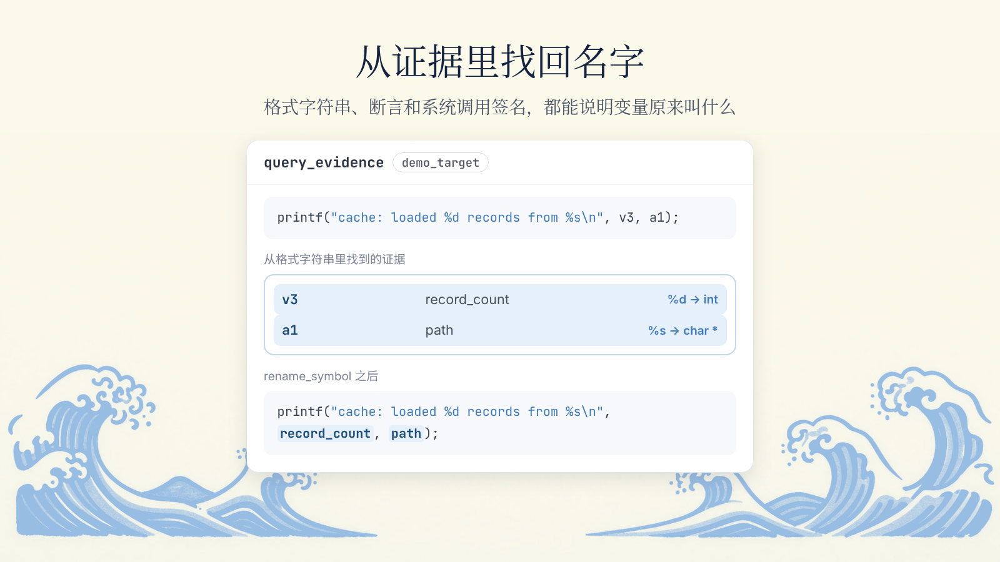
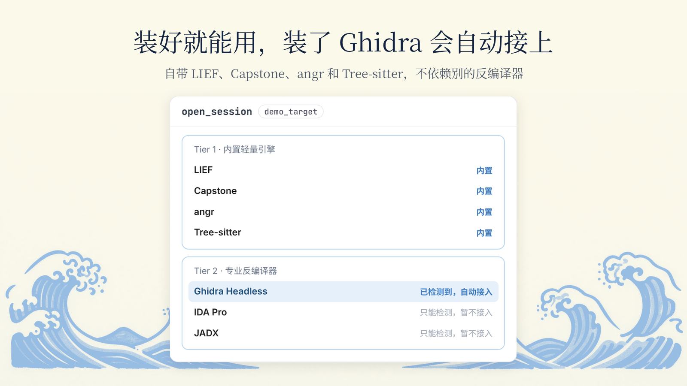
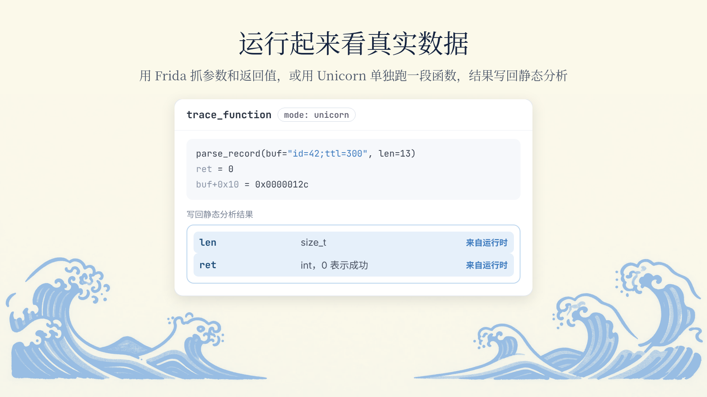
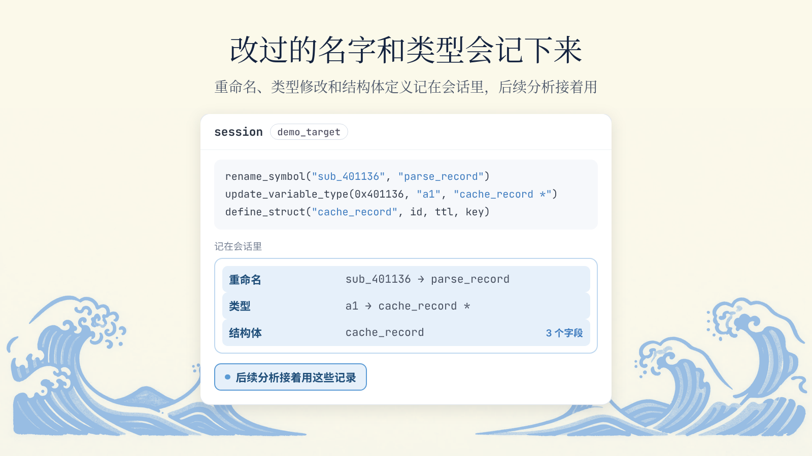
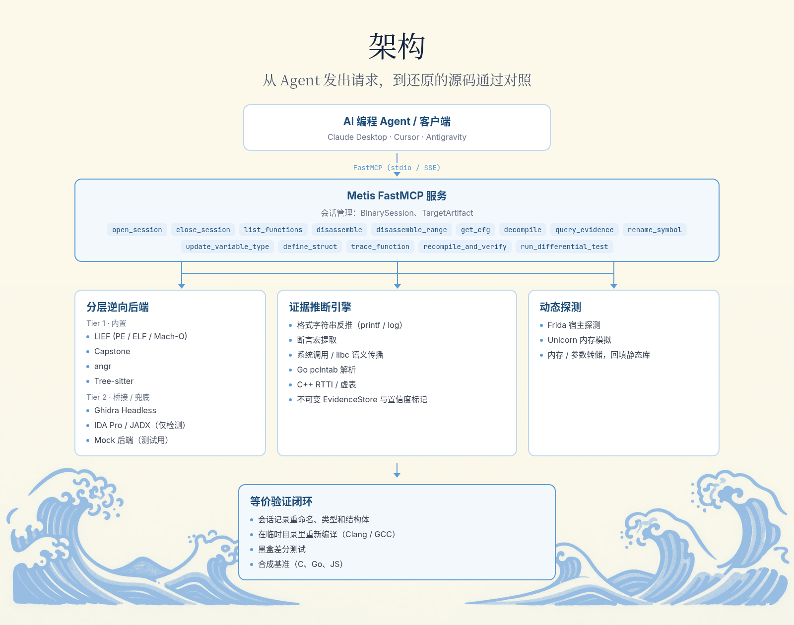
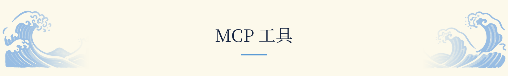

<p align="center">
  
</p>

<p align="center">
  让 AI 编程 Agent 把去掉符号的二进制还原成能重新编译、行为一致的源码。
</p>

<p align="center">
  <a href="README.md">English</a> · <b>简体中文</b>
</p>

<p align="center">
  <a href="https://opensource.org/licenses/MIT"></a>
  <a href="https://www.python.org/downloads/"></a>
  <a href="https://github.com/jlowin/fastmcp"></a>
</p>

<p align="center"></p>

**1. 安装**（需要 Python 3.12 及以上；重新编译验证需要 `clang` 或 `gcc`）

```bash
git clone https://github.com/Wholiver/metis-reverse.git
cd metis-reverse
uv venv && source .venv/bin/activate
uv pip install -e ".[dev]"
```

不用 uv 的话，也可以 `pip install git+https://github.com/Wholiver/metis-reverse.git`。

**2. 接入客户端**：在 MCP 配置里加上下面这段，Claude Desktop、Cursor、Cline、Windsurf 都可以用。

```json
{
  "mcpServers": {
    "metis-reverse": {
      "command": "metis-reverse",
      "args": ["--transport", "stdio"]
    }
  }
}
```

**3. 试一下**：编译自带的示例程序，再让 Agent 去分析它。

```bash
cd demo && make
```

> 分析 `demo/demo_target` 这个去掉了符号的程序。先从格式化字符串和断言里找证据，推出缓存记录的结构体，再还原出 C 源码，并用对照测试验证。

<p align="center"></p>

**从证据里找回名字。** 根据格式化字符串、断言、系统调用签名和语言元数据（Go pclntab、C++ RTTI 等），找回原来的变量名、结构体和类型，每一条都标明出处和可信度。

<p align="center"></p>

**装好就能用，装了 Ghidra 会自动接上。** 自带 LIEF、Capstone、angr 和 Tree-sitter，不依赖别的反编译器；电脑上装了 Ghidra 时会自动接入。

<p align="center"></p>

**运行起来看真实数据。** 用 Frida 在运行时抓参数和返回值，或者用 Unicorn 在内存里单独跑一段函数，再把结果写回静态分析。

<p align="center"></p>

**改过的名字和类型会记下来。** Agent 做的重命名、类型修改和结构体定义都会记在会话里，后续分析接着用。

<p align="center"></p>

**重新编译，逐项对照。** 用 clang 或 gcc 编译还原出来的源码，用同一组输入运行它和原程序，对比退出码、标准输出和错误输出。

<p align="center"></p>

<p align="center"></p>

| 工具 | 作用 |
|:---|:---|
| `open_session` | 打开一个二进制或脚本文件（ELF、PE、Mach-O、DEX、JS），创建分析会话 |
| `close_session` | 关闭会话，释放内存和缓存 |
| `list_functions` | 列出识别到的函数，可按名字和可信度筛选 |
| `disassemble` / `disassemble_range` | 从指定地址开始反汇编 |
| `get_cfg` | 获取整个程序或单个函数的控制流图 |
| `decompile` | 把函数反编译成带证据标注的伪代码 |
| `query_evidence` | 查询某个符号或地址的证据和来源 |
| `rename_symbol` | 重命名符号，并记录理由 |
| `update_variable_type` | 修改局部变量或参数的类型 |
| `define_struct` | 定义结构体，自动算出偏移和大小 |
| `trace_function` | 用 Frida 或 Unicorn 动态跑一个函数，把结果写回证据库 |
| `recompile_and_verify` | 编译还原的源码并做对照验证 |
| `run_differential_test` | 对比原程序和新程序的输出与退出码 |

<p align="center"></p>

<details>
<summary><b>Claude Desktop</b></summary>

配置文件位置：

- macOS：`~/Library/Application Support/Claude/claude_desktop_config.json`
- Windows：`%APPDATA%\Claude\claude_desktop_config.json`
- Linux：`~/.config/Claude/claude_desktop_config.json`

使用虚拟环境时，把 `command` 换成完整路径：

```json
{
  "mcpServers": {
    "metis-reverse": {
      "command": "/path/to/metis-reverse/.venv/bin/metis-reverse",
      "args": ["--transport", "stdio"]
    }
  }
}
```
</details>

<details>
<summary><b>Cursor / Windsurf / Cline</b></summary>

在 `.cursor/mcp.json` 或 Cline 设置里加入快速开始里的那段配置即可。
</details>

<details>
<summary><b>SSE 远程模式</b></summary>

```bash
metis-reverse --transport sse --host 127.0.0.1 --port 8000
```
</details>

<p align="center"></p>

```bash
pytest tests/unit/                     # 单元测试
pytest tests/e2e/                      # 端到端和基准验证
pytest --cov=metis_reverse tests/      # 全部测试并统计覆盖率
```

<p align="center"></p>

Metis Reverse 用到了这些开源项目：

- [FastMCP](https://github.com/jlowin/fastmcp) 和 [Model Context Protocol](https://modelcontextprotocol.io/)
- [LIEF](https://github.com/lief-project/LIEF)：解析 ELF、PE、Mach-O
- [Capstone](https://www.capstone-engine.org/)：多架构反汇编
- [Unicorn](https://www.unicorn-engine.org/)：基于 QEMU 的 CPU 模拟
- [angr](https://angr.io/)：二进制分析和反编译
- [Frida](https://frida.re/)：运行时插桩
- [Tree-sitter](https://tree-sitter.github.io/)：语法树解析
- [Ghidra](https://ghidra-sre.org/)：软件逆向工具套件
- [Rich](https://github.com/Textualize/rich) 和 [Pydantic](https://docs.pydantic.dev/)

<p align="center"></p>

本项目使用 [MIT 许可证](LICENSE)。
