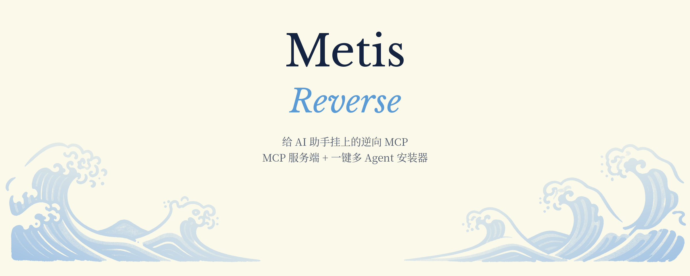
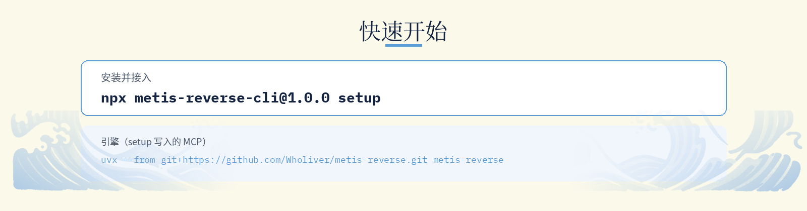
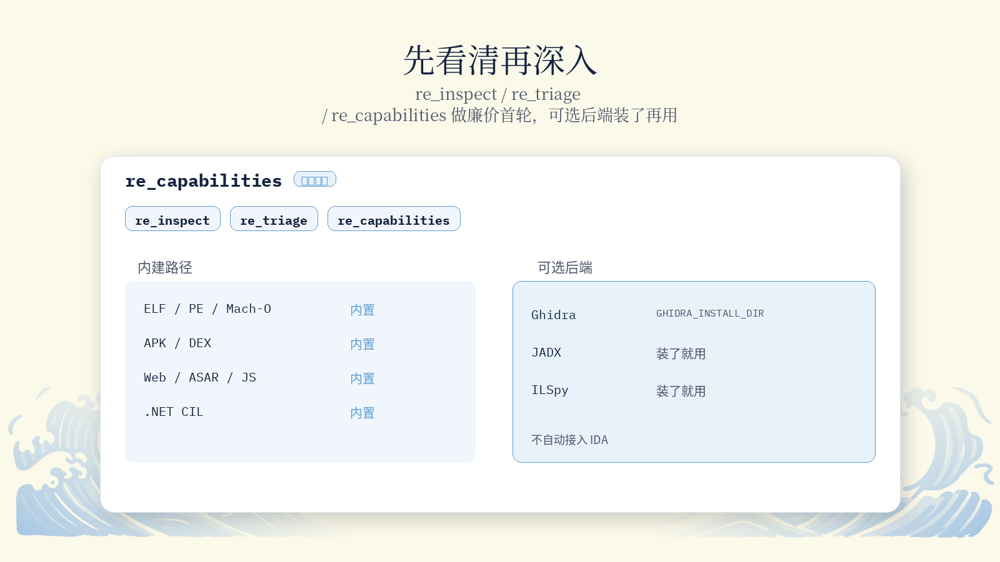
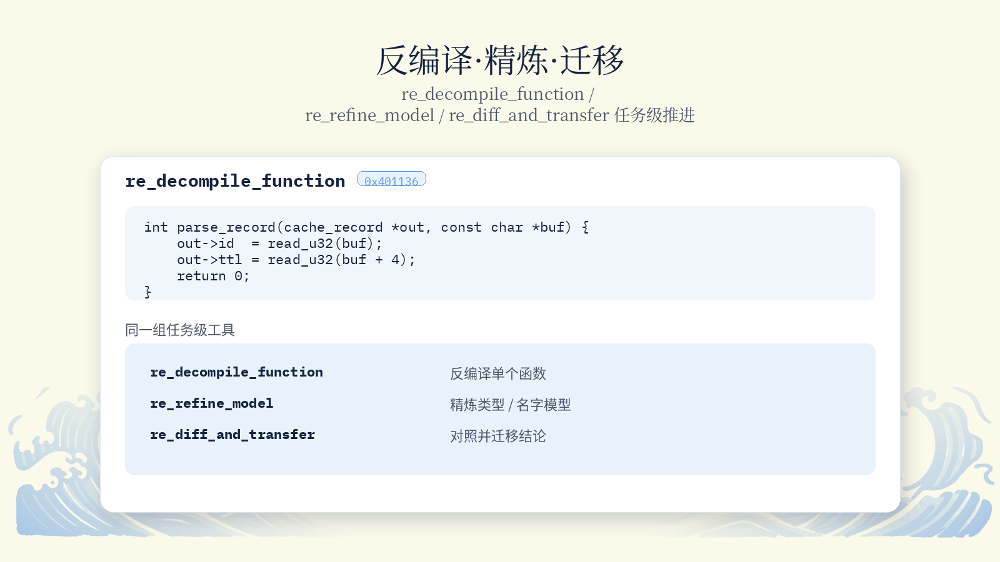
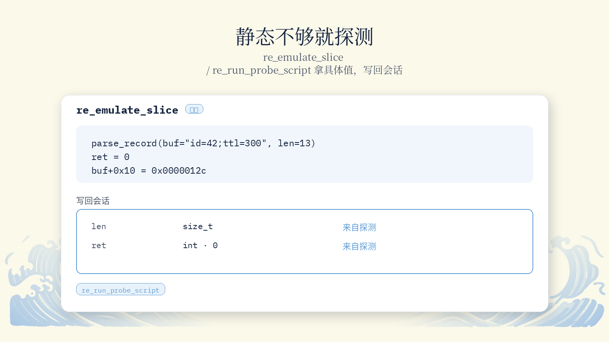
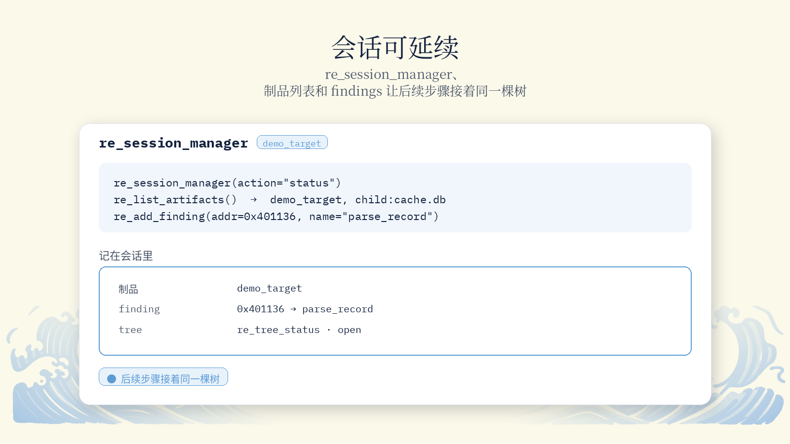
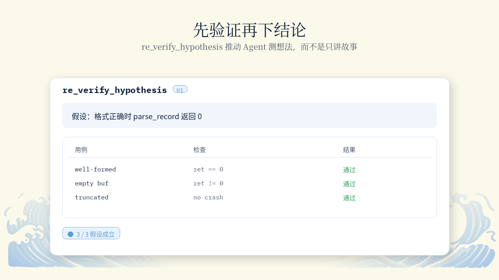
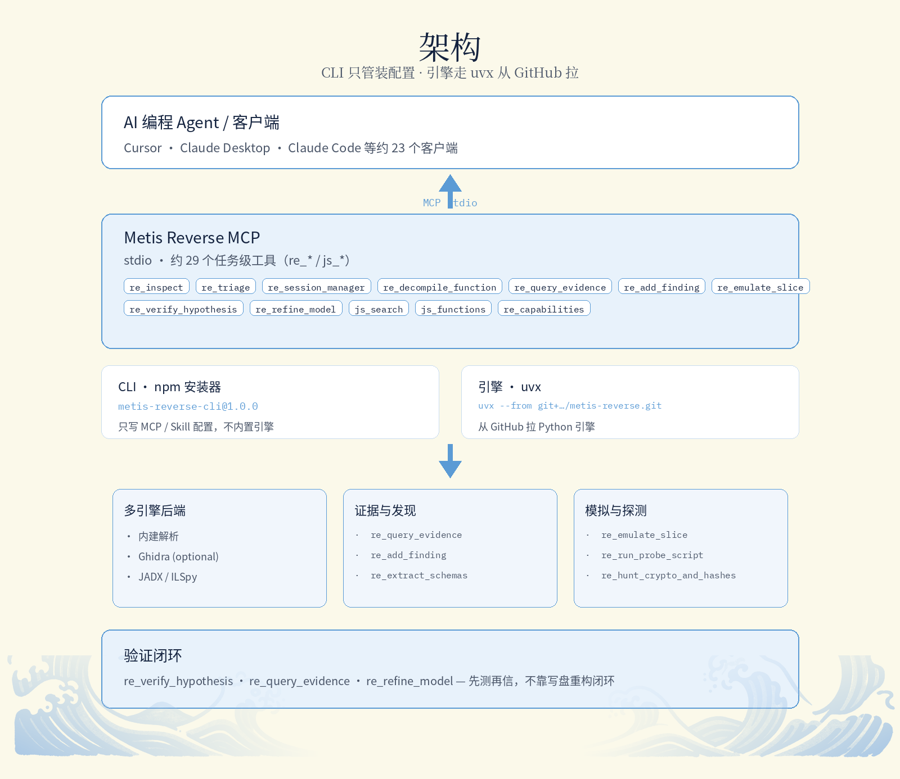
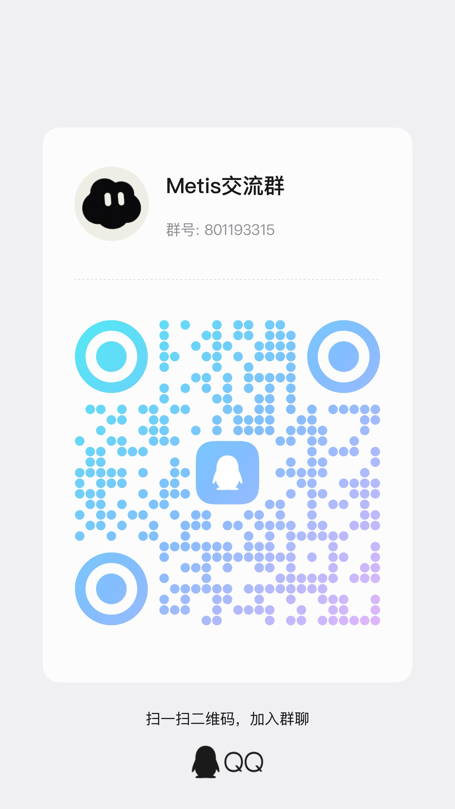

<p align="center">
  
</p>

<p align="center">
  给 AI 助手挂上的逆向 MCP — MCP 服务端 + 一键多 Agent 安装器。
</p>

<p align="center">
  <a href="README.md">English</a> · <b>简体中文</b>
</p>

<p align="center">
  <a href="https://www.npmjs.com/package/metis-reverse-cli"></a>
  <a href="LICENSE"></a>
  <a href="https://www.python.org/downloads/"></a>
  <a href="https://nodejs.org/">=18"></a>
  <a href="https://github.com/Wholiver/metis-reverse/stargazers"></a>
  <a href="#community"></a>
</p>

> **v1.0.1 — 请装对包名。** 正式 CLI 是 [`metis-reverse-cli`](https://www.npmjs.com/package/metis-reverse-cli)（npm dist-tag **`latest` → 1.0.1**）。旧 npm 名 `metis-reverse` 仍停在 **0.0.1**，**不是**本版。推荐：`npx metis-reverse-cli@latest setup`。引擎仓库另有浮动 Git 标签 **`latest`**（当前等于 `v1.0.1`），供 `uvx` / 源码下载。

<p align="center"></p>

**1. 安装并接入。** 需要 [Node.js](https://nodejs.org/) 18+ 和 [uv](https://docs.astral.sh/uv/)（引擎用 `uvx` 从 GitHub 拉；**目前没有** PyPI 包）。

```bash
npx metis-reverse-cli@latest setup
```

或先全局安装 CLI，再跑同一套向导：

```bash
npm install -g metis-reverse-cli@latest
metis setup          # 与 `metis-reverse` 是同一个入口
```

`setup` 会探测本机上的编程 Agent，展示将要写入的内容（MCP + Skill + Cursor rules），给已有 MCP 配置留 `.bak`，确认后再写。看到 `Done.` 后重启 Agent。自检：

```bash
metis doctor
# 或：npx metis-reverse-cli@latest doctor
```

只卸 Metis Reverse（其它 MCP 保留）：

```bash
metis uninstall
```

不写盘的预览 / dry-run：

```bash
metis preview
# 等同：metis setup --dry-run
```

<details>
<summary><b>能配哪些客户端（约 23 个）</b></summary>

`setup` 会出选择列表。跳过菜单可用可重复的 `--client` 加 `--yes`，例如：`metis setup --client cursor --client claude_code --yes`。

| 应用 | `--client` | 应用 | `--client` |
|:---|:---|:---|:---|
| Cursor | `cursor` | Claude Code | `claude_code` |
| Claude Desktop | `claude_desktop` | Codex | `codex` |
| Gemini CLI | `gemini_cli` | Antigravity | `antigravity` |
| VS Code | `vscode` | Windsurf | `windsurf` |
| Trae | `trae` | OpenCode | `opencode` |
| WorkBuddy | `workbuddy` | GitHub Copilot CLI | `copilot_cli` |
| Devin | `devin` | Kimi Code | `kimi` |
| Qwen Code | `qwen_code` | Grok Build | `grok_build` |
| Hermes | `hermes` | Qoder | `qoder` |
| Factory Droid | `droid` | OMP | `omp` |
| Pi | `pi` | ZCode | `zcode` |
| DeepSeek Harness | `dsh` | | |

Cursor 还会写入 `~/.cursor/skills/metis-reverse` 与 `~/.cursor/rules/metis-reverse.mdc`。给 Claude Desktop 跑 `setup` 前请先完全退出该应用。

</details>

<details>
<summary><b>进阶：手写 MCP 配置与源码安装</b></summary>

`setup` 实际写入的内容（引擎走 GitHub + uvx —— **不是** npm，**也不是** PyPI），已钉浮动 **`latest`** 标签（当前 `v1.0.1`）：

```json
{
  "mcpServers": {
    "metis-reverse": {
      "command": "uvx",
      "args": [
        "--from",
        "git+https://github.com/Wholiver/metis-reverse.git@latest",
        "metis-reverse"
      ]
    }
  }
}
```

命令行同理：`uvx --from git+https://github.com/Wholiver/metis-reverse.git@latest metis-reverse`。

可选环境变量（默认不写）：`GHIDRA_INSTALL_DIR`、`METIS_SIDECAR_DIR`。

从源码检出安装（Python **3.10+**），请拉 **`latest`** 标签（或 `v1.0.1`）：

```bash
git clone --branch latest --depth 1 https://github.com/Wholiver/metis-reverse.git
cd metis-reverse
uv venv && source .venv/bin/activate
uv pip install -e ".[dev]"
```

也可直接下源码包：[latest.zip](https://github.com/Wholiver/metis-reverse/archive/refs/tags/latest.zip)。

随后把 MCP 的 `command` 指到该环境的 `metis-reverse`，或继续用上面的 `uvx --from git+…@latest` 形式。

</details>

**2. 试一下。** 进 `demo` 编译，再让 Agent 用 `re_*` / `js_*` 工具去看。

```bash
cd demo && make
```

> 检查 `demo/demo_target`：先 triage，再反编译关键函数，拉证据定名字和类型，有假设就先 verify 再信。

<table>
<tr>
<td width="50%" valign="top"><br><br>

**证据挂在结论上。** `re_query_evidence`、`re_add_finding` 会保留符号/地址的出处，方便 Agent 说明为什么可信。

</td>
<td width="50%" valign="top"><br><br>

**先看清，再深入。** `re_inspect` / `re_triage` / `re_capabilities` 做廉价首轮；装了可选后端（如通过 `GHIDRA_INSTALL_DIR` 接 Ghidra）就用，没装也有内建路径。

</td>
</tr>
<tr>
<td width="50%" valign="top"><br><br>

**反编译、精炼、迁移。** `re_decompile_function`、`re_refine_model`、`re_diff_and_transfer` 等是任务级接口，避免把一堆原子 API 砸给 Agent。

</td>
<td width="50%" valign="top"><br><br>

**静态不够就探测。** `re_emulate_slice`、`re_run_probe_script` 从切片或探测脚本拿具体值，再写回会话。

</td>
</tr>
<tr>
<td width="50%" valign="top"><br><br>

**会话状态可延续。** `re_session_manager`、制品列表和 findings 让后续步骤接着同一棵树，而不是每轮从零开始。

</td>
<td width="50%" valign="top"><br><br>

**先验证，再下结论。** `re_verify_hypothesis` 等工具推动 Agent 测想法，而不是只讲故事。

</td>
</tr>
</table>

<p align="center"></p>

<p align="center"></p>

**v1.0.1 引擎约 29 个 MCP 工具**（`re_*` / `js_*` handlers）。下面按任务分组摘要。

<details>
<summary><b>会话 · triage · 制品</b></summary>

| 工具 | 作用 |
|:---|:---|
| `re_session_manager` | 打开 / 管理分析会话 |
| `re_inspect` | 目标首轮查看 |
| `re_triage` | 廉价排序，找出值得深挖的部分 |
| `re_tree_status` | 分析树状态 |
| `re_list_artifacts` / `re_inspect_artifact` | 列出并检查制品 |
| `re_capabilities` | 当前环境能做什么 |
| `re_register_child_artifact` | 挂上子制品 |

</details>

<details>
<summary><b>二进制结构 · 反编译 · schema</b></summary>

| 工具 | 作用 |
|:---|:---|
| `re_inspect_binary_structure` | 布局 / 段 / 结构 |
| `re_read_file_range` | 读一段字节 |
| `re_translate_address` | 地址换算 |
| `re_query_function` | 函数元信息 |
| `re_decompile_function` | 反编译单个函数 |
| `re_bridge_map` | 桥接 / IPC 一类映射 |
| `re_extract_schemas` | 抽取 schema / 形状 |

</details>

<details>
<summary><b>JavaScript / Electron 类目标</b></summary>

| 工具 | 作用 |
|:---|:---|
| `js_list_modules` / `js_get_module` | 模块 |
| `js_list_closures` | 闭包 |
| `js_search` | 搜索 |
| `js_functions` / `js_strings` | 函数与字符串 |

</details>

<details>
<summary><b>猎取 · 模拟 · 验证 · 证据</b></summary>

| 工具 | 作用 |
|:---|:---|
| `re_hunt_crypto_and_hashes` | 密码学 / 哈希猎取 |
| `re_emulate_slice` | 模拟一段切片 |
| `re_run_probe_script` | 跑探测脚本 |
| `re_verify_hypothesis` | 验证假设 |
| `re_refine_model` | 精炼工作模型 |
| `re_diff_and_transfer` | 对比并迁移结论 |
| `re_query_evidence` / `re_add_finding` | 证据与发现 |

</details>

<p align="center"></p>

| 命令 | 作用 |
|:---|:---|
| `metis setup` | 写入 MCP + Skill（及 Cursor rules）；别名：`init`、`install` |
| `metis doctor` | 探测客户端以及 MCP / Skill 是否已配好；别名：`check`、`status` |
| `metis uninstall` | 只删 `metis-reverse` 相关键 / skill / rules；别名：`remove` |
| `metis preview` | setup 的 dry-run（`setup --dry-run`） |

npm 包提供的 bin：**`metis`** 与 **`metis-reverse`**（同一入口）。

<details>
<summary><b>跑测试（源码树）</b></summary>

```bash
pytest tests/unit/
pytest tests/e2e/
pytest --cov=metis_reverse tests/
```

可选后端（Ghidra、编译器等）不是每套用例都要。空机器上会有部分 skip，属正常。

</details>

<a id="community"></a>

<p align="center"></p>

Metis QQ 群：**801193315**

<p align="center"></p>

<p align="center">本项目支持 <a href="https://linux.do">LINUX DO</a> 社区。</p>

## 鸣谢

构建依赖（以及你本机自行安装时才会用到的可选工具）：

<details>
<summary>展开项目列表</summary>

- [uv](https://github.com/astral-sh/uv) — 安装与 `uvx`  
- [@clack/prompts](https://github.com/bombshell-dev/clack) / [picocolors](https://github.com/alexeyraspopov/picocolors) — CLI 交互  
- [PyYAML](https://github.com/yaml/pyyaml) — 引擎配置  
- 可选：本机若装了 [Ghidra](https://ghidra-sre.org/)、clang / gcc 及其它 sidecar，会按需接入  

完整声明见仓库中的 [THIRD_PARTY_NOTICES.md](THIRD_PARTY_NOTICES.md)（若存在）。贡献者：[CONTRIBUTORS.md](CONTRIBUTORS.md)。

</details>

---

<sub>以 [Apache-2.0 许可证](LICENSE) 发布。引擎与文档：[github.com/Wholiver/metis-reverse](https://github.com/Wholiver/metis-reverse)。CLI 在 npm：[metis-reverse-cli](https://www.npmjs.com/package/metis-reverse-cli)。</sub>
