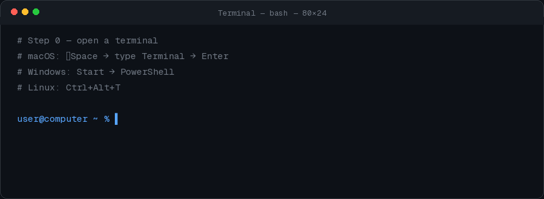
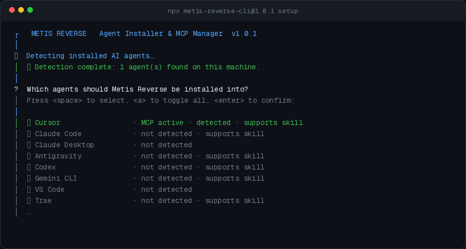
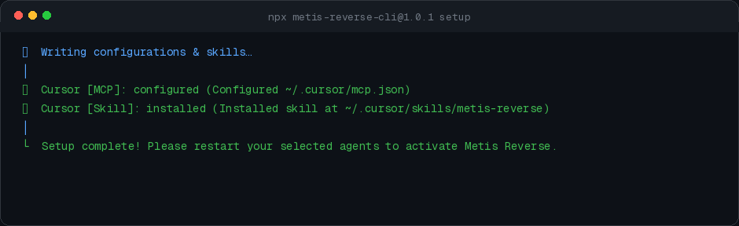
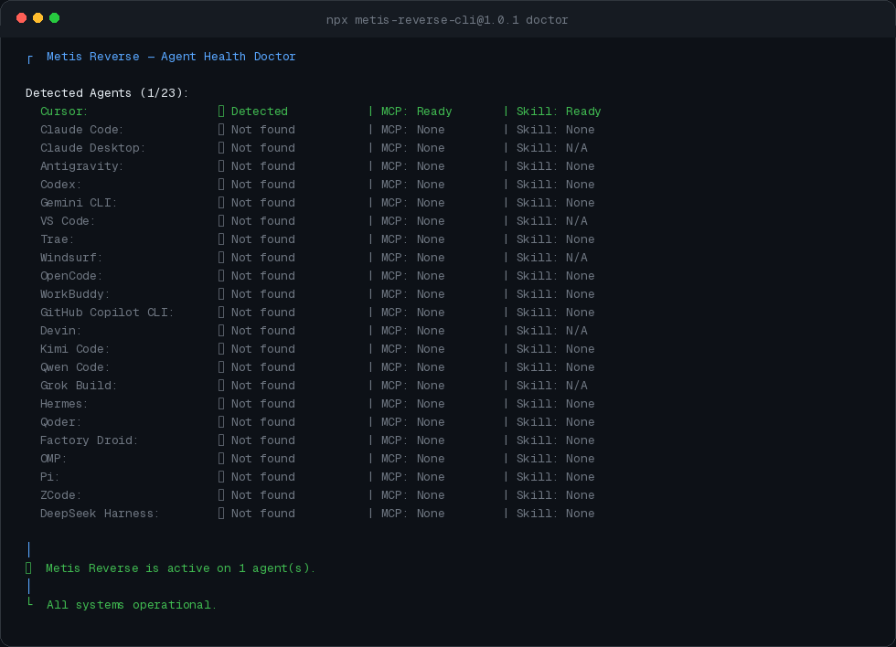

# Metis Reverse Install Guide (1.0.1)

**English** · [简体中文](INSTALL.zh-CN.md)

This guide matches the live CLI (`metis-reverse-cli@1.0.1`). Do **not** reuse older tutorials that mention `Done.`, `Healthy: yes`, a `clients` command, or “111 Python packages”.

**Goal:** attach the Metis Reverse MCP (about 29 `re_*` / `js_*` tools) to coding agents on your machine.  
**Package:** [`metis-reverse-cli`](https://www.npmjs.com/package/metis-reverse-cli) (`latest` → **1.0.1**).  
**Do not install** the old npm name `metis-reverse` (still **0.0.1**).

The engine is **not** on npm. `setup` writes:

`uvx --from git+https://github.com/Wholiver/metis-reverse.git@latest metis-reverse`

(`latest` Git tag currently = `v1.0.1`). There is **no** PyPI package.

---

## Prerequisites

| Need | Notes |
| --- | --- |
| Node.js | **≥ 18** (`node -v` after reopening the terminal) |
| uv | so `uvx` works (`uv --version`) |
| An agent | Cursor, Claude Code, Codex, … (~**23** clients supported) |

---

## 0. Open a terminal

Windows: PowerShell · macOS: Terminal · Linux: usually `Ctrl + Alt + T`.



## 1. Install Node.js

Download **LTS** from https://nodejs.org/en/download , install, **reopen the terminal**, then:

```bash
node -v
```

## 2. Install uv

**Windows (PowerShell):**

```powershell
powershell -ExecutionPolicy ByPass -c "irm https://astral.sh/uv/install.ps1 | iex"
```

**macOS / Linux:**

```bash
curl -LsSf https://astral.sh/uv/install.sh | sh
```

Reopen the terminal and run `uv --version`. Alternatives: `brew install uv`, `winget install --id=astral-sh.uv -e`.

## 3. Run setup

Fully quit **Claude Desktop** first if you use it.

```bash
npx metis-reverse-cli@latest setup
```

Interactive flow (wording from the 1.0.1 source):

1. Detect agents on this machine  
2. **`Which agents should Metis Reverse be installed into?`** — arrows, **Space** to toggle, Enter  



3. **`Install complete Agent Skill package (SKILL.md + reverse references + rules)?`** — default Yes (`--no-skill` to skip)  
4. **Installation Plan** (MCP paths + skill on/off). Existing MCP configs get a **`.bak`**  
5. **`Apply these configurations to selected agents?`** — default Yes  

Success outro:

```text
Setup complete! Please restart your selected agents to activate Metis Reverse.
```



Non-interactive example:

```bash
npx metis-reverse-cli@latest setup --client cursor --client claude_code --yes
```

Or install the CLI globally, then `metis setup`. Dry-run: `npx metis-reverse-cli@latest preview` (= `setup --dry-run`).

## 4. Restart agents

Fully quit and reopen every agent you selected.

## 5. Doctor

```bash
npx metis-reverse-cli@latest doctor
```



You should see per-agent `Detected` / `MCP: Ready` / `Skill: Ready` (or N/A). When configured: `Metis Reverse is active on N agent(s).` → `All systems operational.`

Paths:

```bash
npx metis-reverse-cli@latest doctor --json
```

There is **no** `clients` subcommand in 1.0.x.

Uninstall Metis Reverse only: `npx metis-reverse-cli@latest uninstall`.

In Cursor: **Settings → MCP** → `metis-reverse` with ~**29** tools.

---

## FAQ

- **`node` / `npx` missing** — reinstall Node LTS; reopen terminal.  
- **`uv` / `uvx` missing** — redo step 2; reopen terminal.  
- **Slow npx** — `npx --registry=https://registry.npmmirror.com metis-reverse-cli@latest setup`  
- **Windows script policy** — `Set-ExecutionPolicy -Scope CurrentUser RemoteSigned`  
- **Nothing selected** — Space to check, or `--client cursor --yes`  
- **Wrong package** — use `metis-reverse-cli@latest`, not `metis-reverse@0.0.1`  
- **Still stuck** — paste full `doctor` output into [Issues](https://github.com/Wholiver/metis-reverse/issues)

License: **Apache-2.0**. Repo: https://github.com/Wholiver/metis-reverse
